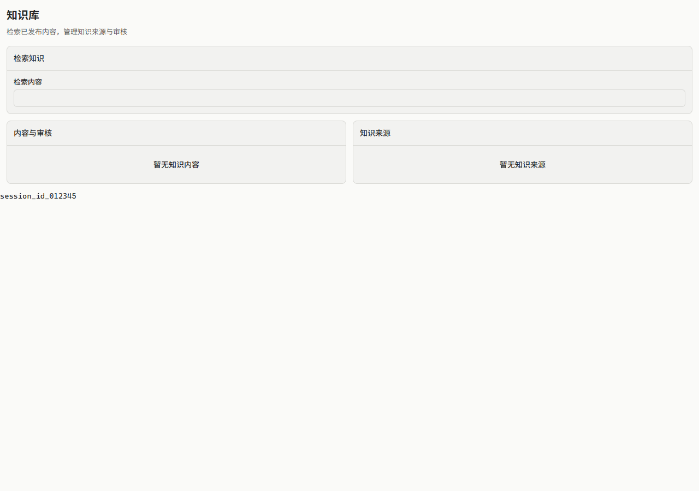
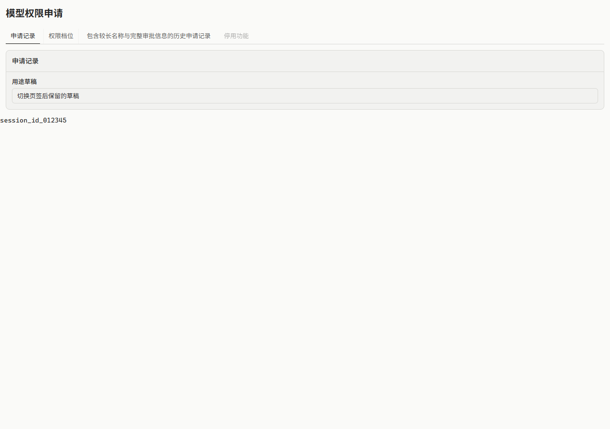

# Page 与 Tabs 间距验证

## 范围与参考

参考用户 2026-10-26 提供的浅色模型权限页与知识库截图：原页面的标题到内容距离分别由
原生标题和应用 PageHeading 决定，Tabs 的指示线还占用了导航与面板之间的空白。
本次在已有组件组合候选上修复公共组件与配方，不修改 OpMaster 的业务页面或发布其应用。

Page 把页头与内容距离集中到 section-gap；标题与说明用 compact-surface-gap，Tabs 与面板用 content-gap。
line Tabs 增加完整底边、自然宽度标签与边界内的选中指示，default 保留分段外观。
长标签在导航内部滚动，公开 orientation 同时传给 Base UI；面板自身保持原选择与焦点行为。
文档、仓库技能、生成配方、Storybook 与编译消费例子同步更新。

## 实际结果

| 验证 | 结果 |
| --- | --- |
| npm run build | UI、Lab、Storybook、Workbench 完整构建通过 |
| npm run check | 配方、组件、token、catalog、设计审计与工作区类型检查通过 |
| 最后 UI 构建与编译消费 | 14 项通过，13.8 秒；不与前次重跑叠加计数 |
| 组件源码检查 | 183 文件、533 类名配方通过 |
| 改动入口、例子与新测试 | 不超过 120 列 |
| git diff --check | 通过 |

编译消费只导入公共包和已发布形式的 CSS，没有应用样式或源码 alias。
新测试覆盖 light/dark × compact/comfortable/dense、default/line、390px、纵向键盘操作、
禁用标签、长标签可达、切换后草稿与公共间距覆盖；既有 7 项组合测试一起运行。

实际测量：Page 页头到内容为 16/20/12px；标题到说明为 4/6/2px；Tabs 导航到面板为 12/16/8px。
line 指示线高度 2px，与导航底边对齐；非选中标签没有左右边框。宽窄屏没有页面横向溢出。
已查看浅色内容页、横向页签、390px 窄屏截图；示例内容为静态公开组合，不代表业务调用。

## 失败与修正

首次长标签测试发现 default 导航居中时，首个标签落到不可滚回的负溢出区域，点击超时。
保留失败日志与截图后，横向导航统一从起点排列；同一窄屏往返场景重跑通过。
下一轮 13 项通过、纵向 1 项失败：orientation 只写了外部数据属性，没有传给 Base UI。
补齐公开属性传递后同范围 14 项通过；最后又按实际截图核验 line 标签左右边框。
原失败与各次重跑保存在本任务工作区的 .dev/，公开文档只保留结论与修正链。

## 截图与交付边界

本次是源码 PR，依赖已有主题与组合 PR #19；未合并、未发布 npm 包、未部署消费应用。
旧应用需要升级兼容包并采用 Page 后才会获得统一页头布局，普通页面不再编写各自的间距补偿。
